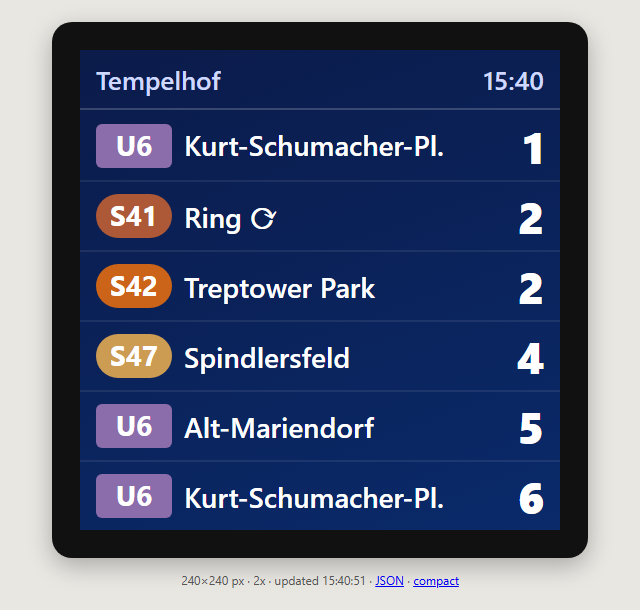
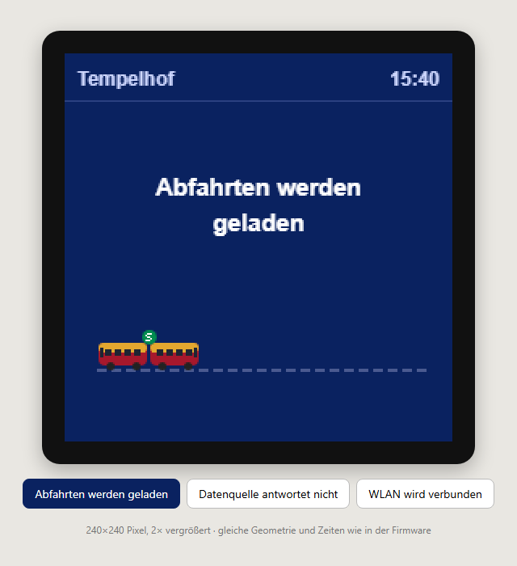
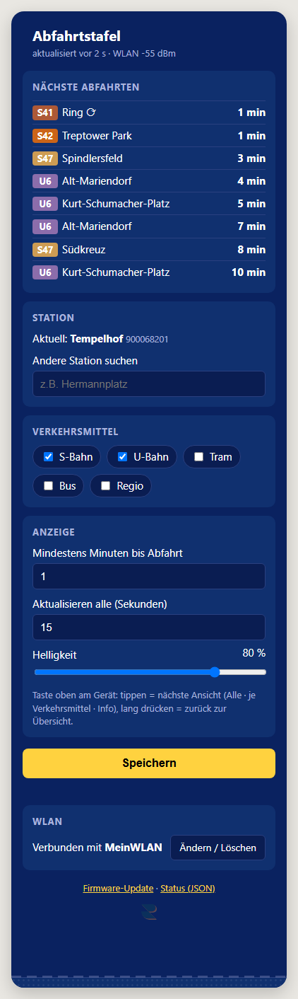

# Abfahrtstafel

A small live departure board for Berlin/Brandenburg public transport, running on a
**GeekMagic SmallTV Pro** (ESP32, 1.54″ 240×240 display). It shows the next S-Bahn and
U-Bahn departures of any VBB stop (tram, bus and regional trains too, if you like), with
real-time data including delays. No PC, no account and no API key needed.

<p>
  
  
  
</p>

*Left: the board (browser preview of the 240×240 screen). Middle: loading screen. Right:
settings page on a phone.*

## Features

- Next 6 departures: line badge in the official colours, destination, minutes until
  departure (live times incl. delays), refreshed every 15 s
- Touch button on top: switch between *all*, *U-Bahn only*, *S-Bahn only* and an *info*
  screen
- Settings page for your phone: station search, transport types, minimum minutes,
  brightness, refresh interval
- WiFi setup from the phone (own hotspot with a QR code); change or delete the WiFi at
  any time
- Over-the-air updates, and a safe mode if a build ever crashes
- Small extras: an S-Bahn shuttling on a rail while loading, trains and buses passing by on
  the settings page

The user interface on the device is in German (*Abfahrten* = departures, *WLAN* = WiFi,
*Einstellungen* = settings).

## What you need

- A **GeekMagic SmallTV Pro**: classic ESP32 with 8 MB flash and a touch button on top.
  Other SmallTV models (Ultra, the ESP8266 and ESP32-C2 variants) are different hardware
  and **won't work**.
- A 2.4 GHz WiFi network (5 GHz is not supported by the ESP32)
- A computer with Git, Python 3.9 or newer and about 2 GB of free disk space (for the
  ESP32 toolchain)
- A 5 V / 1 A USB power supply

## Install it on your SmallTV Pro

No cable to the computer and no opening of the case is needed – everything goes over WiFi.

### 1. Build the firmware

```bash
git clone https://github.com/ruboin/abfahrtstafel.git
cd abfahrtstafel
python -m venv .venv
# Windows: .venv\Scripts\activate      macOS/Linux: source .venv/bin/activate
pip install platformio
cd firmware
cp include/secrets.example.h include/secrets.h   # Windows: copy include\secrets.example.h include\secrets.h
```

Open `firmware/include/secrets.h` and set `OTA_PASS` – the password for future firmware
updates. The WiFi lines can stay as they are; you'll set up the WiFi from your phone.

```bash
pio run
```

The first build downloads the ESP32 toolchain (about 1.5 GB) and takes a few minutes.
The result is `firmware/.pio/build/smalltv_pro/firmware.bin`.

> **Windows:** run the build in PowerShell or cmd, not in Git Bash – PlatformIO's ESP32
> tools refuse to run under MSYS.

### 2. Connect the SmallTV to your WiFi (with its stock firmware)

1. Plug in the SmallTV. Without a known WiFi it opens a hotspot called **SmallTV PRO**
   (no password).
2. Join that hotspot with your phone and open <http://192.168.4.1>.
3. Tap **Network** → **Scan**, pick your WiFi, enter the password and save.
4. The SmallTV restarts and shows its new IP address on the screen. Write it down.

Missed it? Tap the top of the device until the **Settings** app appears and long-press it.

### 3. Check that it really is a SmallTV Pro

Open `http://<ip>/v.json` in your browser. It must say `"GeekMagic SmallTV-PRO"`.
If it says anything else, stop here – this firmware only fits the Pro.

### 4. Upload the firmware

Open `http://<ip>/update`, click **Choose Firmware**, select `firmware.bin` and click
**Update**. It takes about a minute; don't unplug the device meanwhile.

Or from the command line (inside `firmware/`):

```bash
curl -F "firmware=@.pio/build/smalltv_pro/firmware.bin" http://<ip>/update
```

> **Heads-up:** on its first start, Abfahrtstafel deletes the GeekMagic software from the
> device – the stock app in the second app slot, its files (pictures, GIFs) and its
> settings. The screen shows *Alte Software wird gelöscht* with a progress bar for about
> 20 seconds. See [Going back to the stock firmware](#going-back-to-the-stock-firmware).

### 5. Set up the WiFi from your phone

The board now shows **WLAN einrichten** and a QR code.

1. Scan the QR code with your phone camera – or join the WiFi **Abfahrtstafel-Setup**
   by hand.
2. The setup page opens by itself (otherwise go to <http://192.168.4.1>).
3. Pick your network, enter the password and tap **Speichern & neu starten**.

### 6. Pick your station

After the restart the board shows an info screen for 8 seconds – station, WiFi, IP
address and a QR code to the settings page – and then the departures (default stop:
S+U Tempelhof). Open <http://abfahrten.local> (or the IP address) and search for your
station.

## Using it

**Touch button on top**
- Tap: next view – *All* → *U-Bahn* → *S-Bahn* → *Info*. The views follow the transport
  types you enabled; a bus stop gets a bus view, and so on.
- Long press: back to *All*. The info view returns there by itself after one minute.
- Don't touch the button while plugging the board in – it calibrates at power-up.

**Screens**
- Red dot next to the station name: the last update failed; the departures shown are
  older and keep counting down.
- Loading screen with the little S-Bahn: waiting for WiFi, the clock or data. If the data
  source keeps failing, it says so and keeps retrying.

**Web pages**

| Address | What |
|---|---|
| `http://abfahrten.local/` | Settings: station, transport types, minimum minutes, brightness, refresh interval |
| `http://abfahrten.local/wifi` | Change or delete the WiFi |
| `http://abfahrten.local/update` | Firmware update (user `admin`, password `OTA_PASS`) |
| `http://abfahrten.local/api/status` | Status as JSON: errors, departures, touch sensor values |

If `abfahrten.local` doesn't work (some Android phones), use the IP address from the info
screen.

**WiFi**
- Moving to another place: if the saved WiFi isn't found within 30 seconds, the board opens
  the **Abfahrtstafel-Setup** hotspot again.
- *Löschen* on the WiFi page removes name and password completely (the settings storage is
  rewritten, nothing stays behind in the flash) and restarts into setup mode.
- Don't know the IP and want to change the WiFi? Unplug the board 3 times within a few
  seconds after plugging it in – on the third start it opens the setup hotspot.
- An unused setup hotspot restarts after 10 minutes and tries the saved WiFi again.
- WiFis with a login page (hotels, some offices) are not supported.

## Updating

Build as in step 1, then upload `firmware.bin` at `http://abfahrten.local/update`, or:

```bash
curl -u admin:<OTA_PASS> -F "update=@.pio/build/smalltv_pro/firmware.bin" http://abfahrten.local/update
```

If a build crashes three times in a row, the board starts in *Sicherer Modus* (safe mode):
only the setup hotspot with the WiFi page and `/update`, so you can always install a fixed
build without opening the case.

## Going back to the stock firmware

GeekMagic publishes its firmware at
<https://github.com/GeekMagicClock/smalltv-pro/tree/main/firmware>. Unzip the `.bin` and
upload it at `http://abfahrten.local/update`.

Note that the first-start cleanup erased the stock filesystem (pictures, GIFs and whatever
else GeekMagic keeps there). Those files are not part of the published firmware, so the
stock firmware then starts with an empty filesystem – whether all its apps and its web
interface work fully that way is untested. If you want to be able to return to the exact
original state, make a full flash backup **before** step 4 – that requires opening the
case and a 3.3 V USB-UART adapter on the internal header
(`esptool read_flash 0x0 0x800000 backup.bin`).

## Try it without the device

The `devserver/` folder contains a small Flask app that previews the board and serves the
device's web pages with example data:

```bash
cd devserver
pip install -r requirements.txt
python app.py
```

- <http://localhost:5000> – board preview (240×240, shown at 2×)
- <http://localhost:5000/loading> – the loading screens with the S-Bahn animation
- <http://localhost:5000/device> – the settings page
- <http://localhost:5000/wifi> – the WiFi page
- `python cli.py` – departures in the terminal

## Project layout

```
firmware/                 PlatformIO project for the SmallTV Pro
  src/main.cpp            everything that runs on the device
  include/settings.h      pins, defaults, timing, data source
  include/webpage.h       settings and WiFi pages, styles, passing trains
  include/secrets.example.h
  partitions_smalltv_pro.csv
devserver/                Python preview and test server
docs/                     screenshots
```

More technical details: [firmware/README.md](firmware/README.md).

## How it works

- **Data**: [transport.rest](https://v6.bvg.transport.rest), the community REST API for
  BVG/VBB timetables (`v6.bvg.transport.rest`, falling back to `v6.vbb.transport.rest`).
  It's free and needs no key – please keep the refresh interval reasonable (the default of
  15 s means 4 requests per minute). VBB's own app backend redirects ESP32 clients to its
  [official API](https://unternehmen.vbb.de/digitale-services/api/), which you can apply
  for by email if transport.rest ever becomes unreliable.
- **Firmware**: Arduino core 2.0.17 on PlatformIO (`espressif32@6.9.0`), Arduino_GFX for
  the display, U8g2 fonts (with umlauts), ArduinoJson, the ESP-IDF QR code component.
  Loading runs in its own FreeRTOS task on core 0; display, button and web server run on
  core 1, so neither ever waits for the other.
- **Flash layout** is identical to the stock firmware (two 2.125 MB app slots plus a
  3.7 MB filesystem), which is why GeekMagic's own web updater accepts the image.

### Hardware (GeekMagic SmallTV Pro)

| Part | Connection |
|---|---|
| Display | ST7789, 240×240 IPS, SPI mode 3, 40 MHz |
| SCLK / MOSI | GPIO 18 / GPIO 23 |
| DC / RST | GPIO 2 / GPIO 4 |
| CS | tied to GND on the board |
| Backlight | GPIO 25, active low (PWM) |
| Touch button | GPIO 32 (capacitive, T9) |
| Flash | 8 MB |

## Troubleshooting

| Problem | What to do |
|---|---|
| `pio run` fails in Git Bash on Windows | Use PowerShell or cmd. |
| Build fails with "No space left on device" | The ESP32 toolchain needs about 2 GB of free disk space. |
| Board not reachable | Tap through to the info screen for the IP, or use the 3× unplug trick to open the setup hotspot. |
| Button reacts badly | Check `touch` in `/api/status`: a tap must drop the reading below `base × 0.88`. Adjust `TOUCH_RATIO` in `settings.h`. |
| "Datenquelle antwortet nicht" | transport.rest is having a hiccup; the board keeps retrying. |
| Screen stays black after flashing | Wrong hardware variant – see step 3. On a Pro, try `TFT_BL_INVERTED false` in `settings.h`. |

## Credits

- Pin map and flash layout: [smalltv-mod](https://github.com/jkjyys/smalltv-mod) and the
  [ESPHome community config](https://community.home-assistant.io/t/installing-esphome-on-geekmagic-smart-weather-clock-smalltv-pro/618029)
  for the SmallTV Pro
- Departure data: [transport.rest](https://v6.bvg.transport.rest) by Jannis Redmann
  (derhuerst)
- Libraries: [Arduino_GFX](https://github.com/moononournation/Arduino_GFX),
  [U8g2](https://github.com/olikraus/u8g2), [ArduinoJson](https://arduinojson.org)
- GeekMagic for the hardware and for publishing the stock firmware

Not affiliated with BVG, VBB, S-Bahn Berlin or GeekMagic. Line colours are used for
recognisability only.

## License

[MIT](LICENSE)
